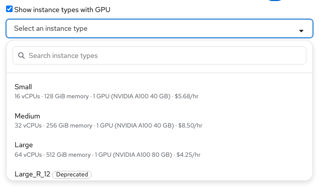

# Catalog items — UX handoff

Contact: Yifat Friman Menchik, UXD  
Jira: [HPUX-2175](https://redhat.atlassian.net/browse/HPUX-2175)  
Google Doc: [Catalog items](https://docs.google.com/document/d/1YTm2X4nUXWVI_Mjq_hXEY4Rj6i9BaOiXjzVeF3jcMA4/edit)  
Interactive mock: [Catalog, Cloud provider admin](https://osac-project.github.io/osac-ux/vmaas-ux-prototype.html?v=0c53b14&role=provider)

The provider Catalog list supports publish-state and tenant filters, search, and card and table views. Both views use compact PatternFly pagination above and below the list: an item-range dropdown with Previous and Next.

The Create VM Catalog Item wizard runs **Details → Compute configuration → Storage → Access & Initial run → Review**. Details sets scope, name, description, and provisioning template. A provisioning template option shows its name above its description. The selected template name or ID appears in Review and catalog item details.

Compute configuration sets guest OS, disk image, and instance type. Instance type options show the **resource name first** and the CPU, memory, and any GPU count and readable model in a second-line description, followed by the rate. For example: **small-gpu** / `1 vCPU · 2 GiB memory · 1 GPU (NVIDIA A100 40 GB) · $1.90/hr`. Do not show PCI device IDs in this menu. Keep Deprecated selectable and labeled; omit Obsolete from new choices. Existing Obsolete values remain visible until replaced.

Long instance type names wrap to two lines above their resource description. If a name still does not fit, truncate it and reveal the full name on hover or keyboard focus. Keep the full name available to screen readers, including in the Instance types list.

The same lifecycle distinction applies to disk images in the catalog item wizard: keep Deprecated options selectable and labeled; omit Obsolete images from new choices.

The provider can edit an instance type from its details page. Edit opens on **Configuration**, with vCPUs, memory, and GPU fields visible immediately; General remains available for scope, description, and labels. The name stays read-only.

For field governance, storage, initial-run data, publication, and details behavior, follow the [Google UX handoff](https://docs.google.com/document/d/1YTm2X4nUXWVI_Mjq_hXEY4Rj6i9BaOiXjzVeF3jcMA4/edit).
