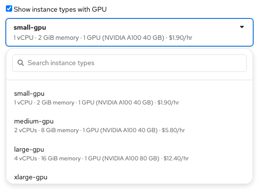
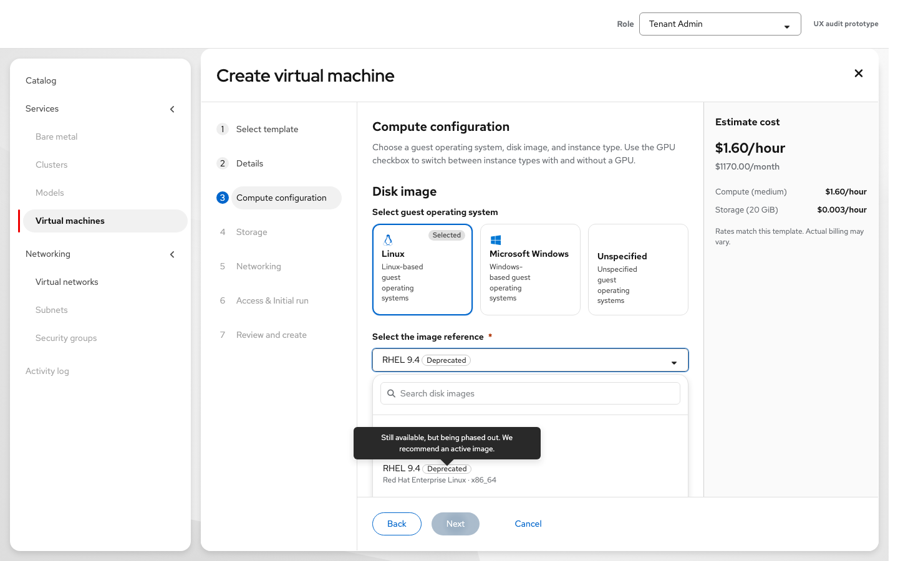

# Create virtual machine — UX handoff

Contact: Yifat Friman Menchik, UXD  
Jira: [HPUX-2031](https://redhat.atlassian.net/browse/HPUX-2031)  
Google Doc: [Create Virtual machine](https://docs.google.com/document/d/1LL0iWhIIh3gAhJAsm7MCpnlFxfzaOXkZS_MVI6dSfSo/edit)  
Interactive mock: [Create VM, Tenant Admin](https://osac-project.github.io/osac-ux/vmaas-ux-prototype.html?v=0c53b14&role=admin)

The template-first wizard runs **Select template → Details → Compute configuration → Storage → Networking → Access & Initial run → Review and create**. Template rules keep locked settings visible and identify editable settings. Back and Next retain values; leaving after editing asks before discarding.

In Compute configuration, select the guest OS family and disk image, then review or select the instance type. The **instance type name is the first line** of every option. The second line gives vCPUs, memory, and any GPU count and readable model, followed by the rate. Example: **small-gpu** / `1 vCPU · 2 GiB memory · 1 GPU (NVIDIA A100 40 GB) · $1.90/hr`. Do not expose the PCI device ID in the label. The selected control uses the same name and description. The GPU checkbox switches between GPU and non-GPU types.

Long instance type names wrap to two lines above the resource description. If the name still does not fit, truncate it and show the full name on hover or keyboard focus; keep the full name available to screen readers. The same rule applies in the resize picker and Instance types list.

Deprecated types remain selectable with a label and tooltip. Obsolete types are omitted from new choices. If a template defaults to an Obsolete type, require a replacement when editable or direct the user to another catalog item when locked. See [instance type lifecycle selection](instance-type-lifecycle-selection.md).

Apply the same lifecycle distinction to disk images: a Deprecated image remains selectable and labeled; an Obsolete image is unavailable for a new VM.
The explanation appears when hovering the **Deprecated** label or focusing its option, rather than hovering anywhere in the option.

The VM list uses compact PatternFly pagination: an item-range dropdown, Previous, and Next. It appears above and below card and table views.

For the rest of the wizard, follow the [Google UX handoff](https://docs.google.com/document/d/1LL0iWhIIh3gAhJAsm7MCpnlFxfzaOXkZS_MVI6dSfSo/edit).
