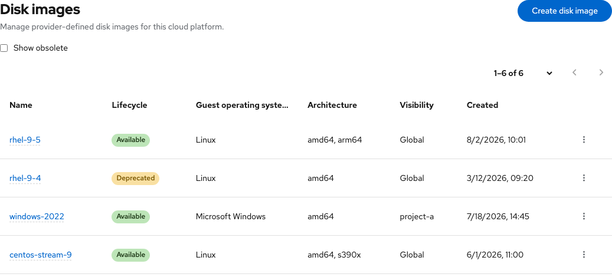

# Disk images — UX handoff

Contact: Yifat Friman Menchik, UXD  
Google Doc: [Disk images](https://docs.google.com/document/d/1tKrg2Wb2bmD6ny6Iqw87ysnMRwHjj6XmDttc-rv05a4/edit)  
Interactive mock: [Disk images, Cloud provider admin](https://osac-project.github.io/osac-ux/vmaas-ux-prototype.html?v=38890d7&role=provider)

Disk images are provider-managed references with metadata, visibility, and lifecycle controls. The list uses compact PatternFly pagination above and below the results: an item-range dropdown plus Previous and Next. The dropdown changes items per page (10, 20, 50, or 100). Filtering resets to the first page.

Follow the [Google UX handoff](https://docs.google.com/document/d/1tKrg2Wb2bmD6ny6Iqw87ysnMRwHjj6XmDttc-rv05a4/edit) for the create, edit, and details flows.
