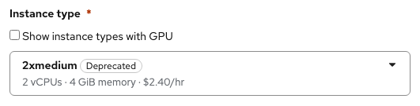
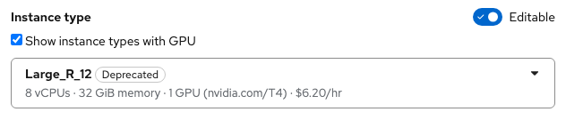
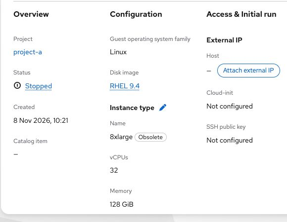
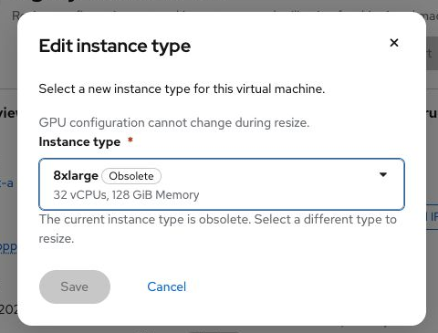
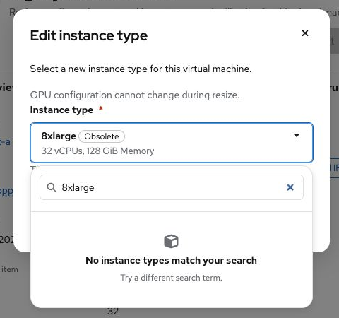

# Instance type lifecycle in selection menus

Contact: Yifat Friman Menchik, UXD  
Updated: 12 November 2026

Interactive mockup: https://osac-project.github.io/osac-ux/vmaas-ux-prototype.html?v=0c53b14&role=admin&vm=windows-golden-eider-58

This rule applies to the instance type menus in **Create VM**, **Create VM Catalog Item**, and **Edit instance type** (resize).

Every option uses the instance type name as its first line and CPU, memory, and, when present, GPU count and readable model in its description. Do not show PCI IDs in the visible description. The selected type keeps its lifecycle label; compatibility checks still use the full GPU specification.

Long names wrap to two lines. Keep the description below the name. If the name exceeds two lines, truncate it and show the full name on hover or keyboard focus while preserving the full accessible name. The same treatment applies in the Instance types list.

- **Active:** selectable without an additional label.
- **Deprecated:** selectable with a **Deprecated** label. Anchor its tooltip to the label, not the whole menu option. On hover or focus, show: “Still available, but being phased out. We recommend an active type.” Keep the label visible after selection.
- **Obsolete:** omit from menus for new VMs, catalog items, and resizes. New targets cannot use an Obsolete type.

An existing VM or catalog item that uses a Deprecated or Obsolete type still displays its current type and lifecycle label on its details page. Do not silently replace the current value when the edit form opens. If the current type is Obsolete, show it as the existing value and explain that a different type must be chosen for a new VM or resize. Keep Obsolete out of the menu of new targets. The UI must receive lifecycle status from the instance type data rather than infer it from the name.

If a selected catalog item or template still has an Obsolete type as its default, the Create VM wizard must not silently substitute another type or create the VM with that default. If instance type is editable, require a valid replacement. If it is locked, explain that the user must choose a different catalog item.

This lifecycle rule also applies to other selectable resources, including disk images: keep Deprecated resources available and visibly labeled for as long as the API reports them as Deprecated. They may remain in that state for a long time. Reserve Obsolete for resources unavailable as new choices; preserve an existing selection in its detail and edit views.
For disk images, the label tooltip reads: “Still available, but being phased out. We recommend an active image.”

Related: [VM resize handoff](osac-4281-vm-resize-handoff.md) · [OSAC-7656 lifecycle bug](https://redhat.atlassian.net/browse/OSAC-7656) · [OSAC-4281 resize](https://redhat.atlassian.net/browse/OSAC-4281)

## Screenshots

**Create VM:** Deprecated remains labeled after selection.

**Create VM Catalog Item:** Deprecated remains labeled after selection.

**Existing VM:** The current Obsolete type remains visible on Overview and in Resize. Save stays disabled until a replacement is selected.

**Obsolete:** hidden from selection menus, including search results.

