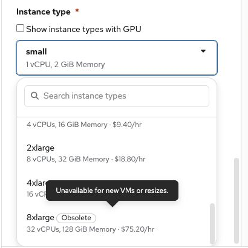
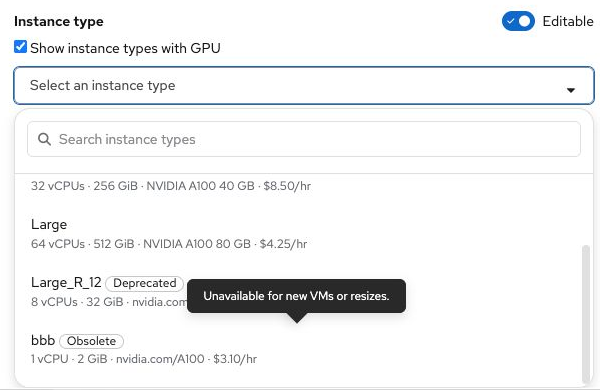

# Instance type lifecycle in selection menus

Contact: Yifat Friman Menchik, UXD  
Updated: 11 November 2026

Interactive mockup: https://osac-project.github.io/osac-ux/vmaas-ux-prototype.html?v=555caae&role=admin&vm=windows-golden-eider-58

This rule applies to the instance type menus in **Create VM**, **Create VM Catalog Item**, and **Edit instance type** (resize).

- **Active:** selectable without an additional label.
- **Deprecated:** selectable with a **Deprecated** label. On hover or focus, show: “Still available, but being phased out. We recommend an active type.” Keep the label visible after selection.
- **Obsolete:** visible with an **Obsolete** label, but unavailable for selection. On hover or focus, show: “Unavailable for new VMs or resizes.”

An existing VM or catalog item that uses a Deprecated or Obsolete type still displays its current type. Do not silently replace the current value. The UI must receive lifecycle status from the instance type data rather than infer it from the name.

Related: [VM resize handoff](osac-4281-vm-resize-handoff.md) · [OSAC-4281](https://redhat.atlassian.net/browse/OSAC-4281)

## Screenshots

**Create VM:** Obsolete is visible but cannot be selected.

**Create VM:** Deprecated remains labeled after selection.

**Create VM Catalog Item:** Both lifecycle states appear in the instance type menu.

