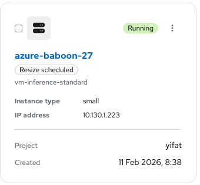
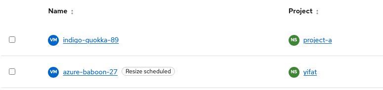
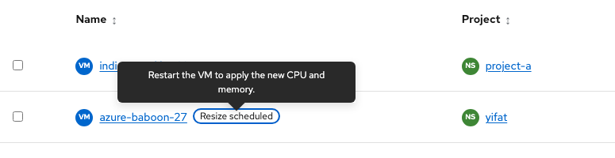
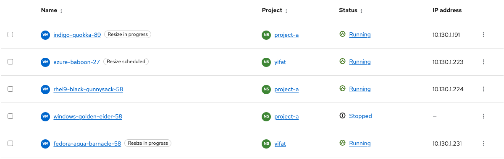
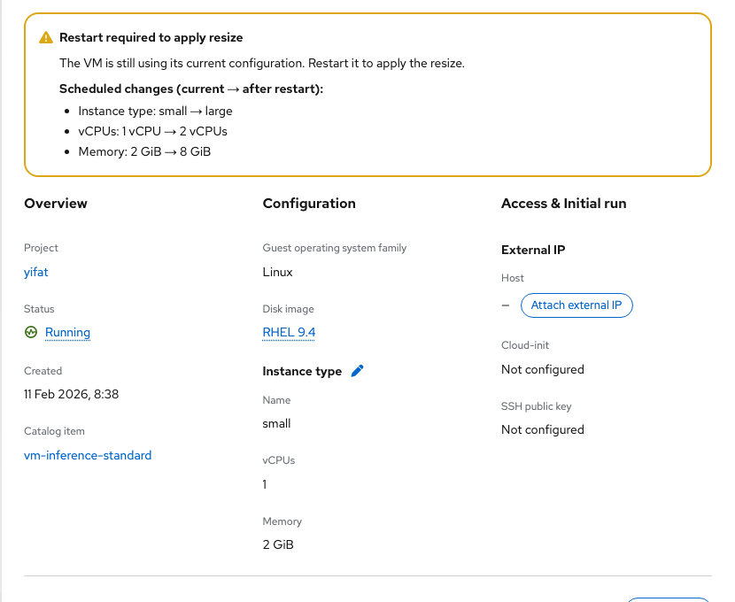
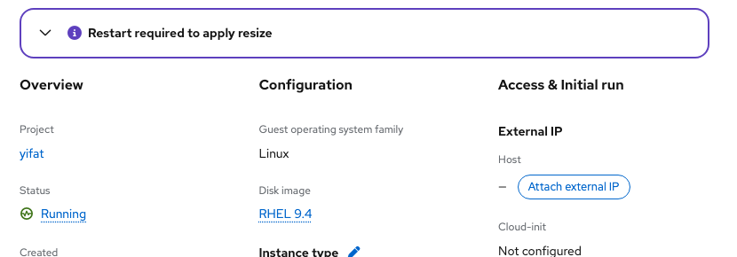
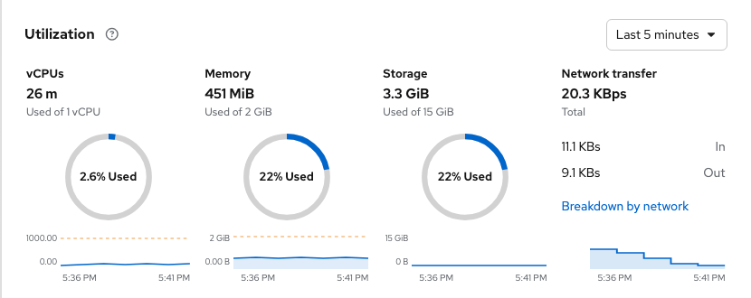

# VM resize via instance type

Contact: Yifat Friman Menchik, UXD  
Updated: 10 November 2026

UX Google Doc: https://docs.google.com/document/d/1kgln_LzTA3-VSP0SUM0jLce2Nvw0pix3oTYkwZuX-wE/edit  
Interactive mockup: https://osac-project.github.io/osac-ux/vmaas-ux-prototype.html?v=2155730&role=admin&vm=azure-baboon-27
Feature: [OSAC-4277](https://redhat.atlassian.net/browse/OSAC-4277)  
Resize: [OSAC-4281](https://redhat.atlassian.net/browse/OSAC-4281)  
Related work: [OSAC-7576](https://redhat.atlassian.net/browse/OSAC-7576), [OSAC-7463](https://redhat.atlassian.net/browse/OSAC-7463), [OSAC-7582](https://redhat.atlassian.net/browse/OSAC-7582), [OSAC-6578](https://redhat.atlassian.net/browse/OSAC-6578)

## Entry and availability

On VM Overview, select the pencil beside Instance type. Tenant Admin and Tenant User can resize. The action is available for Running, Paused, and Stopped VMs, and unavailable during transitional states or while another resize is in progress.

## Select an instance type

The modal has a required typeahead Instance type field and Save/Cancel actions. Each option shows its name, vCPUs, memory, GPU count and model, and rate. The VM's GPU configuration cannot change during resize. Exclude instance types with a different GPU count or resource. Do not predict hot-plug or restart from boot-disk access mode before submission. Show submit failures inside the modal.

## After Save

A success toast confirms the saved request. For a Running or Paused VM that requires restart, show a persistent PF6 info notification at the top of VM Overview: **Restart required to apply resize**. Keep the VM's **active** instance type, vCPUs, and memory as the main configuration values, including the CPU and memory totals in Utilization. Under **Scheduled changes**, show current → requested values for instance type, vCPUs, and memory without repeating “Configuration” before each field. Use the expandable alert, collapsed by default to save vertical space. The title stays visible; expanding reveals the description and change list. New scheduled changes reset it to collapsed so the default layout remains compact. A Restart action in the notification is optional and depends on the supported VM action.

On the VM list, retain the normal power status (for example, Running). Add a separate, neutral, outlined PatternFly 6 **Resize scheduled** label beside the VM name. Its tooltip says, “Restart the VM to apply the new CPU and memory.” A Stopped VM's new size applies on its next start.

## Resize in progress

When the API reports that a resize is applying without a restart, keep **Running** as the VM power state and show a separate **Resize in progress** label in card and table views and beside Status on VM Overview. Its tooltip says, “The new CPU and memory are being applied without a restart.” Keep the active instance type, CPU, and memory as the main values until the API confirms the new configuration is active. The mockup uses `indigo-quokka-89` for this state.

After the user restarts a VM with a scheduled resize, remove **Restart required** and show the same compact **Resize in progress** label while the resize is still applying, even if the VM power state has returned to **Running**. Its tooltip says, “The VM has restarted. The new CPU and memory are still being applied.” Do not prompt for another restart. The mockup uses `fedora-aqua-barnacle-58` for this state; restarting `azure-baboon-27` also demonstrates the transition.

Do not show a persistent progress notification, timing details, or a Recent activity entry for this brief operation. Remove the progress label only when the API confirms completion, then show the new instance type, CPU, and memory as active values and a brief success toast. Keep configuration progress separate from the VM power state, as required by OSAC-6578. These states require operation phase and active versus requested values from the API; the mockup timer only demonstrates completion and must not be used as production logic. If the operation stalls or fails, show a prominent message with details.

The API must expose or allow derivation of both active and requested configuration values, the restart-required condition, and the resize operation phase. Backend acceptance of the update depends on OSAC-5328.

## Current mockup screenshots

**Resize scheduled badge on the VM list.** The tooltip appears on hover or keyboard focus.

**Resize scheduled badge in the VM table view.**

**Resize scheduled tooltip in the VM table view.** Show it on hover or keyboard focus of the label.

**VM table with separate power and resize statuses.** `indigo-quokka-89` is applying without restart; `azure-baboon-27` needs restart; `fedora-aqua-barnacle-58` is still applying after restart.

**Expanded info notification showing scheduled changes and the active configuration on VM Overview.**

**Default collapsed info notification.** The title remains visible, and the toggle opens the scheduled changes.

**Utilization before restart shows the active 1 vCPU and 2 GiB.**

## Provisioning failure (separate state)

When provisioning fails, show **Failed to provision** in the VM list and overview instead of leaving the VM at Starting. Show the failure reason. Do not invent Stop, Cancel, or Retry actions; add a recovery action only after the backend supports a safe transition. Track this separately in [OSAC-7582](https://redhat.atlassian.net/browse/OSAC-7582).
