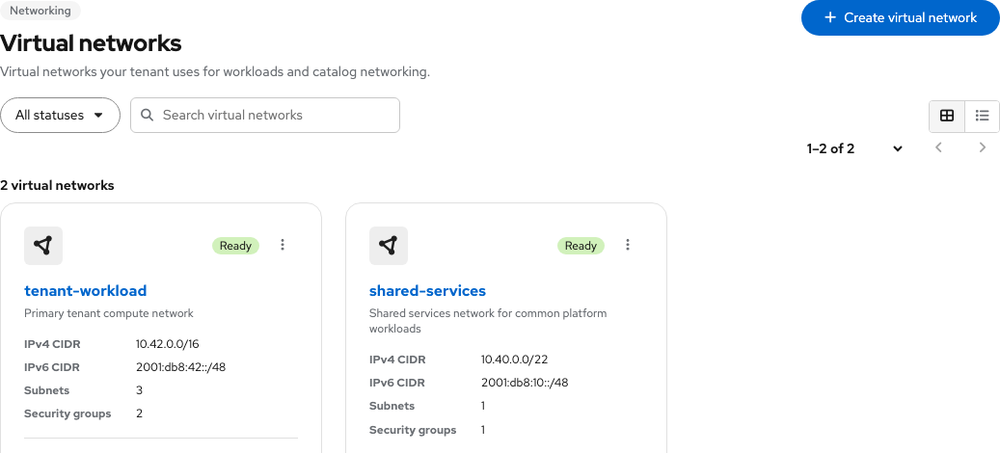

# Tenant Networking — UX handoff

Contact: Yifat Friman Menchik, UXD  
Google Doc: [Tenant Networking](https://docs.google.com/document/d/1Bb-TzaXkhdASe6btymwRk2u0wXycwyqS-I8h637hDGY/edit)  
Interactive mock: [Tenant Networking, Tenant Admin](https://osac-project.github.io/osac-ux/vmaas-ux-prototype.html?v=38890d7&role=admin)

The Virtual networks list uses compact PatternFly pagination above and below the results: an item-range dropdown plus Previous and Next. The dropdown changes items per page (10, 20, 50, or 100). Filtering resets to the first page.

Follow the [Google UX handoff](https://docs.google.com/document/d/1Bb-TzaXkhdASe6btymwRk2u0wXycwyqS-I8h637hDGY/edit) for network and external IP attachment behavior, including loading and failure states.
