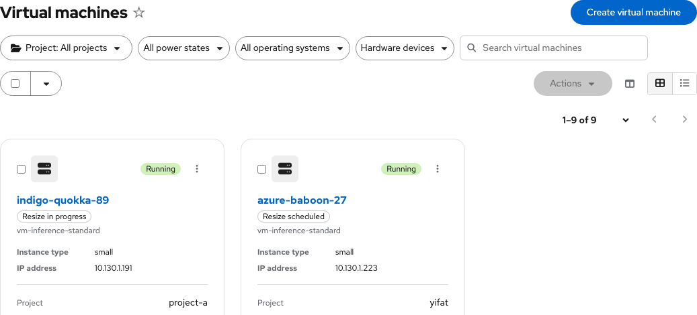
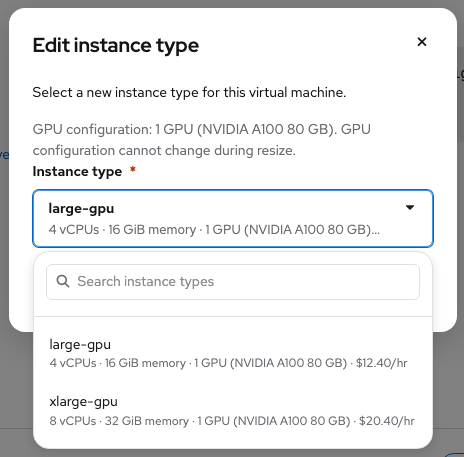

# VM Overview — UX handoff

Contact: Yifat Friman Menchik, UXD  
Google Doc: [VM Overview](https://docs.google.com/document/d/1Y8hjgE924owve0VXA3rkKqTYuB4sXKif8KhXyFL3hyQ/edit)  
Interactive mock: [VM Overview, Tenant Admin](https://osac-project.github.io/osac-ux/vmaas-ux-prototype.html?v=38890d7&role=admin&vm=indigo-quokka-89)

VM Overview shows the active instance type, CPU, and memory. Editing the instance type opens the name-first, two-line picker: each option has the resource name above CPU, memory, GPU count and readable model when present, and rate. Omit PCI hardware IDs from visible labels. The GPU specification still determines which resize targets are compatible. See the [resize handoff](osac-4281-vm-resize-handoff.md).

When a resize requires a restart, a persistent **info** notification at the top says “Restart required to apply resize.” It is collapsed by default and expands to show current and requested values. The VM list retains its power status and adds a neutral **Resize scheduled** label with a restart tooltip. During application, show **Resize in progress** as a compact status label. Keep active values visible until completion.

The VM list uses compact PatternFly pagination in card and table views: an item-range dropdown plus Previous and Next above and below the results.

For access, networking, storage, utilization, failure states, and permissions, follow the [Google UX handoff](https://docs.google.com/document/d/1Y8hjgE924owve0VXA3rkKqTYuB4sXKif8KhXyFL3hyQ/edit).
